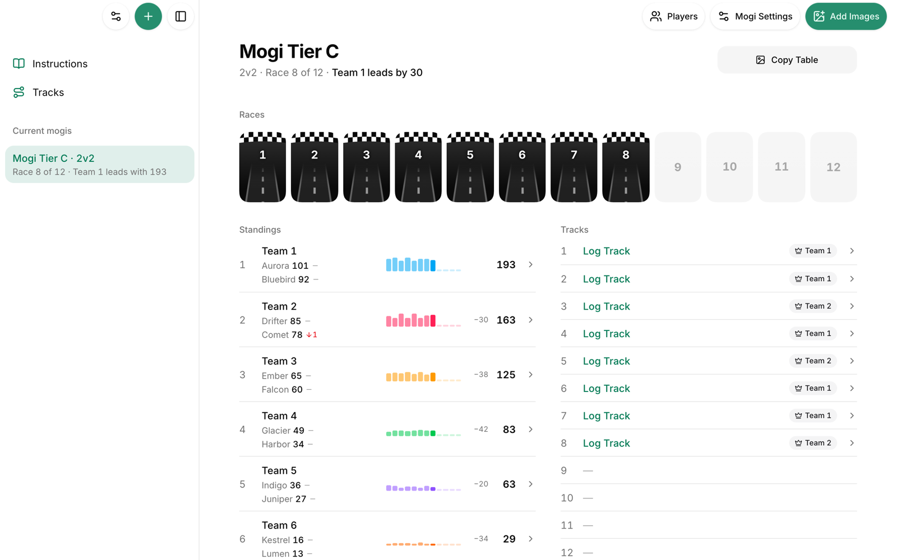

# Mogi on Rails

A tracker for 12-player Mario Kart World Lounge mogis. Paste the Lounge bot list, add the Switch screenshots of each race, and the app reads the results on your device with OCR, asks only about what stayed uncertain, and hands you the standings, the table image and the `!submit` command.

Nothing goes to a server: data stays on the device, the app works offline after the first visit, and ZIP backups carry everything from one device to another.



<sub>Screenshot from a local build with made-up fixture players.</sub>

## Features

- **Screenshots in, results out.** Add screenshots by picker, paste, drag and drop or a watched folder on desktop Chrome; [PaddleOCR](https://github.com/PaddlePaddle/PaddleOCR) (PP-OCRv6 Tiny) reads names, places and points in a browser worker.
- **One question at a time.** Whatever the OCR or the evidence can't settle (an unreadable name, a missing race, a disputed total) becomes a single queue of questions with the likeliest answer preselected.
- **Reconstruction.** Totals are proven from the game's cumulative points, so a missed screenshot doesn't break the standings; unknown stays unknown instead of guessed.
- **Lounge formats.** FFA, 2v2 and 3v3, with substitutes, absent players and credit handled by the Lounge rules.
- **Exports.** Copy the `!submit` command for the Lounge bot or the table as a PNG, or save the results as text.
- **Tracks.** Per-track statistics across your mogis, to choose what to vote for and what to practice.
- **Installable and offline.** A PWA with a silent offline cache, adaptive layouts for phone and desktop, and light and dark themes.

## Repository layout

| Path | What it is |
| --- | --- |
| [`apps/web`](apps/web) | The app (`@mkw/web`): React, TypeScript, Tailwind and shadcn/ui on [Vinext](https://github.com/cloudflare/vinext), exported as a static site. |
| [`packages/engine`](packages/engine) | `@mkw/engine`: recognition, scoring, sequence and reconstruction rules, tested through its public API. |
| [`apps/switch-airdrop`](apps/switch-airdrop/README.md) | A small Swift helper for macOS that moves AirDropped Switch screenshots into a folder the app can watch. Outside the npm workspaces. |
| [`docs`](docs/README.md) | Contracts (the current rules per area), ADRs and research. |

How the pieces fit: [ARCHITECTURE.md](ARCHITECTURE.md). Domain vocabulary: [GLOSSARY.md](GLOSSARY.md).

## Commands

Requires Node `^22.18.0 || >=23.6.0`. Browser tests need Google Chrome and Python 3.

```bash
npm ci
```

| Command | What it does |
| --- | --- |
| `npm run dev` | Development server; downloads and verifies the OCR models on first run, then prints the local URL. |
| `npm test` | Engine rules, app rules and the quick journey in Chrome (45 s budget). |
| `npm run check` | The full gate: rules, types, lint, design checks, production build, React Compiler check and every browser spec (5 min budget). |
| `npm run lint` | English check, Prettier on the engine, ESLint and design-system checks. |
| `npm run build` | Static production build into `dist/client`. |

Which test to run for which change, and how to run them in parallel worktrees: [docs/contracts/quality.md](docs/contracts/quality.md). CI runs the steps that need neither Chrome nor the OCR models: [`.github/workflows/ci.yml`](.github/workflows/ci.yml).

### Why both `next.config.ts` and `vite.config.ts`

Vinext reimplements the Next.js API on top of Vite, so the app is written as a Next.js App Router project but built and served by Vite. Each file configures its own layer:

- [`apps/web/vite.config.ts`](apps/web/vite.config.ts) is the Vite config the `vinext` CLI loads. It registers the `vinext()` plugin (with the React Compiler set to fail the build on any diagnostic) and the hosting plugin, and holds plain Vite options such as the dev server.
- [`apps/web/next.config.ts`](apps/web/next.config.ts) holds the Next.js options. The `vinext()` plugin reads it and translates it for Vite; here it only sets `output: "export"`, the static export with no server.

Vinext merges its own Vite config with yours. It can also take the Next options inline (`vinext({ nextConfig })`, which overrides `next.config.*`); this repo keeps them in `next.config.ts` so they read as in any Next.js app. `apps/web/scripts/run-framework.mjs` starts the `vinext` CLI for `dev` and `build`.

## Working with agents

The repository is set up for coding agents. They start at [AGENTS.md](AGENTS.md), which points each kind of change to the contract it must read first; people can use the same map.

## License

[MIT](LICENSE). Third-party notices: [apps/web](apps/web/THIRD_PARTY_NOTICES.md), [packages/engine](packages/engine/THIRD_PARTY_NOTICES.md).
